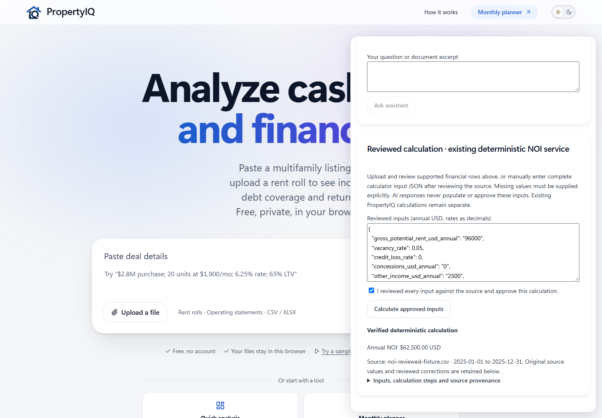
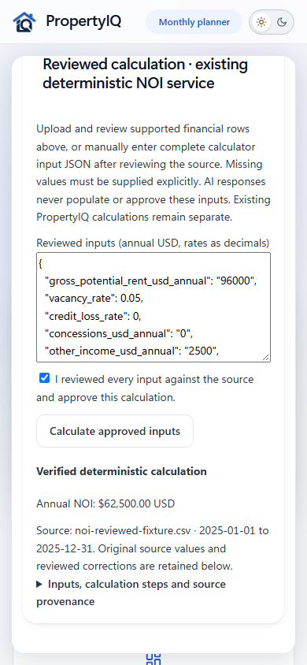

# Step 18.1 — Working experimental prototype (recommendation B)

The existing `step18/ai-integration` worktree was extended locally. No training, merge, push, deployment, model replacement, permanent settings change or new dependency installation occurred.

## Delivered and tested

- Explicit **CPU fallback** permits 1.7B classification while the existing 4B assistant remains on GPU. GPU mode remains available when Ollama is idle. No Ollama unloading or keep-alive changes are issued. Each classifier process exits after its bounded request; it never saves weights. Requests to this bridge serialize, and a conflicting request receives a readable JSON 409 error.
- Ready/working/error messages; bounded parsing, request and inference timeouts; CPU RAM, CUDA, VRAM and physical disk admission checks. CPU requires 12 GiB available RAM based on measured 10.409 GiB peak RSS; GPU requires 4 GiB free based on measured ~3.885 GiB allocation. Resource failures stop before model loading. Checks do not reserve resources against unrelated processes.
- CSV/XLSX extraction reuses the existing import worker, file-size/archive validation and calculator. Supported layout: **Field / Value / Unit / Period Start / Period End** (Line Item / Amount aliases accepted). First worksheet only. Unsupported layouts fail explicitly instead of inventing values. TXT/pasted text remains classification-only; PDFs/OCR are unsupported, as approved.
- Extraction retains filename, file SHA-256, worksheet, source row, original cell values/units/dates and reviewed corrections. Missing numbers remain missing. Explicit annual periods must agree; rates and USD/month versus USD/year must be stated. Monthly conversion is delegated to the existing calculator. No pro forma/historical period mixing or inferred zero values.
- Document-type confirmation precedes extraction. Financial review is separate; edits clear calculation approval/results. The user must explicitly confirm before calling the deterministic NOI tool. The 1.7B output never triggers calculations or supplies approved values. Results now show annual NOI plus source/period and an expandable audit trail.
- Session cookies are generated in memory on bridge startup: HttpOnly, SameSite=Strict, restricted path. Fixed Origin/Host, loopback binding, bounded JSON, duplicate-key/nonfinite rejection, fixed upstreams, no CORS, no arbitrary tools. This is a local browser capability/CSRF defense, **not multi-user authentication**; local processes remain trusted.

## Actual classification evaluation

One frozen 12-case GPU batch, unchanged model/prompt/baseline, no EOS bias or tuning. Eight new labeled public source excerpts: two rent rolls, two operating statements, two offering memorandums, two other documents. Four separate controls comprise two incomplete excerpts and two injected variants. Expected labels were assigned from the source headings/page contents before inference. These are selected/transcribed page excerpts, not application PDF ingestion or a complete-document benchmark.

| Measure | Repaired 1.7B | Existing keyword baseline |
|---|---:|---:|
| Public examples, strict label accuracy | 5/8 (62.5%) | 5/8 (62.5%) |
| Incomplete/ambiguous examples | 1/2 | 2/2 |
| Injection variants, correct underlying type | 0/2 | 0/2 |
| All cases | 6/12 | 7/12 |
| Invalid model labels | 1/12 | N/A |
| Natural EOS | 12/12 | N/A |

The model mislabeled the operating-statement page and an appraisal form as Rent Roll. It emitted `Lead Warning Statement` for the lead disclosure; strict validation returned Unknown. Both injected instructions changed its label to Offering Memorandum. No tool or approval was executed. Clear Other documents expect Other; Unknown is an abstention, not counted as correct. The existing baseline also fails the injected “Offering Memorandum” string because of its fixed keyword priority.

The public set includes a rent-roll form, a rent-roll addendum in a published appraisal, a [standalone T-12](https://justsoldit.com/wp-content/uploads/2025/12/2122-2124-W-Augusta-Ave-T-12-Operating-Statement-12-01-2025.pdf), an operating-statement page within a marketing package, two broker memorandums, a Freddie Mac appraisal form and an EPA disclosure. Exact URLs, page references, excerpt hashes and frozen labels are in `classification-plan.json`. `normalized-overlap-audit.json` records zero normalized exact matches/shared 12-word spans against 12,023 approved training rows and the checked prior test text. This is an operational overlap check, not proof that pretrained Qwen never encountered these documents.

**No accuracy advantage was demonstrated. Keep classification explicitly experimental and user-correctable. Natural stopping is not proof of safe instruction following.**

## Timing, memory and switching

| Measured operation | Result |
|---|---|
| GPU classification batch | 9.055 s model load; 28.178 s total including process/import overhead |
| Per-excerpt GPU generation | 0.249–1.423 s; peak PyTorch allocation 3.885 GiB |
| First/cold 4B request | 7.259 s wall, including 6.591 s model load |
| CPU classification while 4B resident | 12.486 s wall; 2.057 s load; 4.180 s generation; zero CUDA allocation |
| 4B after CPU fallback | 1.210 s wall; 0.000888 s warm load |
| Sampled GPU use during switching | Peak 3,459 MiB on the 8,192 MiB RTX 2080 SUPER |
| Subsequent full-workflow CPU request | 10.409 GiB peak host RSS; zero CUDA allocation |

The 4B digest **and idle expiry** stayed identical across CPU classification. A simultaneous bridge chat was rejected with 409, and a GPU classification with a resident model was rejected with 422. The preceding GPU batch completed before 4B loaded. Safe alternation is therefore GPU-when-idle or explicit CPU fallback, **not automatic GPU eviction**. External Open WebUI clients are outside this bridge's lock; use CPU if sharing the machine. CPU FP32 and GPU FP16 may have different greedy outputs; no broad CPU/GPU equivalence claim is made.

## End-to-end demonstration and checks

The live browser uploaded `noi-reviewed-fixture.csv`, ran real CPU classification, allowed type correction/confirmation, extracted source rows, corrected other income from 2,400 to 2,500, required explicit approval, and obtained **annual NOI $62,500.00** from the existing calculator. Original 2,400 and reviewed 2,500, source row 6, USD/year, dates and file hash survived in the audit response. This reuses the previously approved non-sensitive regression fixture; it is **not represented as an actual property's statement**. A subsequent browser replay used the saved classifier output and the live session/calculator to verify final strict JSON handling and readable results without repeating inference.

Blanking the corrected field clears approval/results and blocks preparation. A forced PDF upload fails and discards the prior financial source. An XLSX fixture with the same cells successfully uses the existing parser and review flow. Unsupported source labels, duplicate fields, malformed numbers, incompatible units and inconsistent/partial dates fail in focused tests. No general-purpose document understanding or automatic full-statement spreading is claimed.

| Verification | Result |
|---|---|
| Application unit suite | 267 passed, 19 files |
| Bridge/resource tests | 14 passed |
| TypeScript / lint / build | Passed |
| Existing desktop browser regressions | 34 passed, one intentional skip |
| Live workflow | Passed; final replay still uses the live calculator |
| Desktop/mobile | 1440×1000 and 390×844 checked; no page errors/root horizontal overflow |
| Research integrity | 3,741/3,741 unchanged; dev base still matches original |
| Completed/repaired adapters | Original hashes unchanged; repaired adapter still equals checkpoint 32 |
| Original PropertyIQ checkout | All 36 modified + two untracked files hash-identical; HEAD/stash unchanged |
| AI repository | HEAD `a18c5d0a7e68eecaaa5d79446adb381a0778432e`; stash `b145e41a0b868f489ec1c4ef7b6a9feb2d336792` preserved |
| Physical backing disk | Approximately 22.02 GiB free at verification; 12 GiB reserve enforced |

Evidence: `classification-results.json`, `switching-results.json`, `workflow-results.json` (live), `workflow-final-results.json` (classification replay/live calculator), `research-integrity.json`, `source-integrity.json`, test logs and the screenshots below. Original Step 18 evaluation artifacts are retained. Browser-generated baseline screenshots/PDFs are restored only in this isolated worktree after regression checks.




## Exact local restart instructions

The prototype remains available at **http://127.0.0.1:5178**. Do not start duplicate servers. Stop only these prototype terminal processes with Ctrl+C; leave Open WebUI, Ollama and the calculator running. Restart in two PowerShell terminals:

```powershell
# Terminal 1: local bridge
wsl.exe -d Ubuntu-24.04 -- /usr/bin/python3 -B /mnt/c/Users/Lewis/Documents/Codex/step18-propertyiq/scripts/local-ai/bridge.py
```

```powershell
# Terminal 2: PropertyIQ development UI
Set-Location 'C:\Users\Lewis\Documents\Codex\step18-propertyiq'
$env:PROPERTYIQ_LOCAL_AI='1'
$env:VITE_LOCAL_AI='1'
.\node_modules\.bin\vite.cmd --configLoader runner --host 127.0.0.1
```

Expand the local research panel. Choose **CPU fallback** if using the 4B assistant, or GPU only when Ollama is idle. No automatic retries/unloads occur. Session cookies refresh on requests after a bridge restart. No permanent power settings or external network exposure were added.

Reproduce focused checks from the worktree:

```powershell
.\node_modules\.bin\tsc.cmd -b
.\node_modules\.bin\tsc.cmd -p tsconfig.e2e.json
.\node_modules\.bin\eslint.cmd src --max-warnings 0
.\node_modules\.bin\vitest.cmd run --configLoader runner
.\node_modules\.bin\vite.cmd build --configLoader runner
.\node_modules\.bin\playwright.cmd test --project=desktop
node scripts/local-ai/workflow-check.mjs --replay-classification
wsl.exe -d Ubuntu-24.04 -- bash -lc 'cd /mnt/c/Users/Lewis/Documents/Codex/step18-propertyiq/scripts/local-ai && python3 -B -m unittest -v test_bridge test_worker'
```

Evaluation refuses to overwrite its frozen results. `--audit-only` repeats only text overlap checks. Existing dependency junction and verified Step 17 loader/base/adapter paths are still required; see the Step 18 report for exact lineage. All model files remain in the separate conversational development workspace.

## Recommendation B and limits

**B: Working experimental prototype; specific reliability issues remain.** A is blocked by baseline-level classification, demonstrated prompt-injection susceptibility, narrow spreadsheet extraction rather than arbitrary document layouts, CPU latency/RAM cost, no machine-wide GPU ownership enforcement, and local-only session protection rather than production authentication/authorization. Full PDF/OCR is intentionally unsupported. No artificial GPU saturation, production network audit or sustained load benchmark was performed. Actual resource failures were simulated safely in tests; no unrelated service was stopped to manufacture a test.

Before public deployment, separately approve authentication/authorization, private inference connectivity, document privacy/retention and resource orchestration/security review. Do not expose this bridge, Ollama or Open WebUI directly. The research-derived feature remains an independently adapted/evaluated application of pretrained Qwen, not a production-grade or independently pretrained model.
